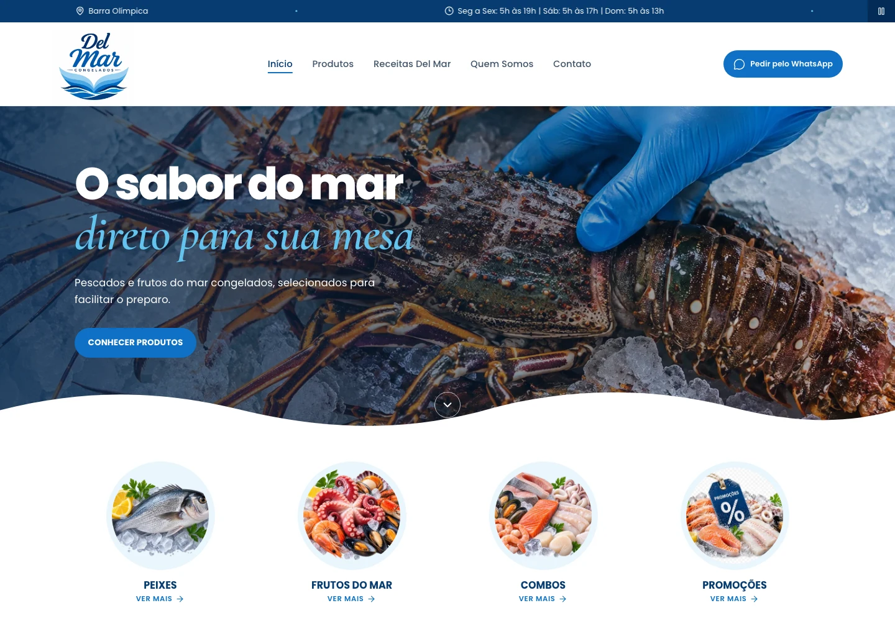
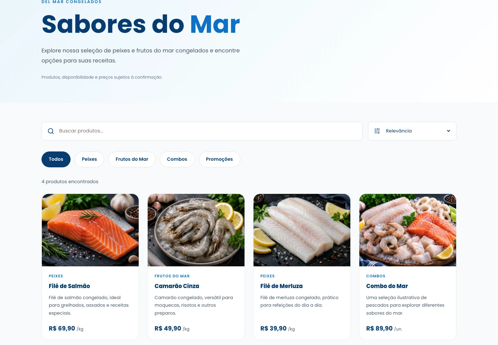
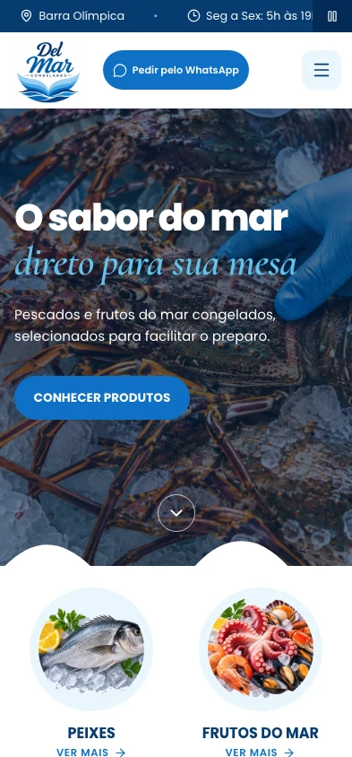
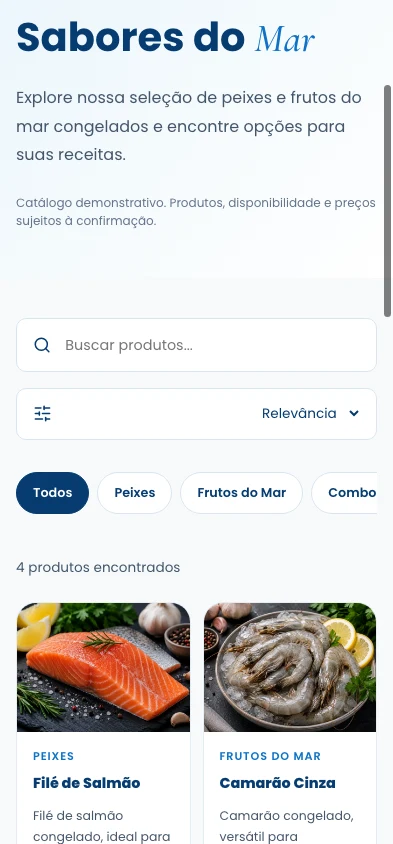

<h1 align="center">Del Mar Congelados</h1>

<p align="center">
  A Brazilian Portuguese catalog and institutional website for a frozen seafood business linked to Casa Del Mar Meriti.
</p>

<p align="center">
  
  
  
  
</p>

## Overview

Del Mar Congelados brings Casa Del Mar Meriti’s seafood experience to a selection of frozen products designed for everyday cooking. The parent business operates the physical shop in São João de Meriti, Rio de Janeiro. This website introduces the frozen product operation, explains its relationship with the parent business and helps visitors find product information.

The first release is a presentation catalog. Customers will confirm availability, pricing and service conditions through the brand’s dedicated WhatsApp number once it is supplied. Shopping cart, checkout, online payments and inventory management are outside the first release.

## Pages and features

| Route | Purpose |
| --- | --- |
| `/` | Brand introduction, category shortcuts, postcode lookup, featured products and a curated Instagram gallery |
| `/produtos` | Demonstration catalog with search, category filters, sorting and a service inquiry section |
| `/quem-somos` | Business background, selection principles and link to the catalog |
| `/receitas`, `/receitas/:slug` | Seafood recipes with illustrative images |
| `/contato` | Commercial channel status and the parent business’s Instagram |
| Other addresses | Client-side page-not-found view |

The Instagram section supports manually curated local images and optional links to original posts. Four selected images are displayed alongside a link to the parent profile.

The home page uses ViaCEP to look up Brazilian addresses. Delivery eligibility is evaluated against a separate local configuration, which is awaiting the confirmed service-area list.

## Screenshots

Captured from the local production build in Chrome at 1440 × 1000 and 393 × 844. The Products captures are scrolled to show the catalog. [Screenshot files](docs/screenshots/)

<table>
  <tr><th>Home</th><th>Products</th><th>Quem Somos</th></tr>
  <tr><td></td><td></td><td></td></tr>
  <tr><td></td><td></td><td></td></tr>
</table>

[Home video and storefront illustration](docs/screenshots/home-institutional-desktop.webp) · [Quem Somos institutional imagery](docs/screenshots/about-institutional-desktop.webp) · [Footer with the transparent logo](docs/screenshots/footer-desktop.webp)


## Stack and structure

React, JavaScript ES modules, React Router, Vite, CSS Modules, Lucide, React Icons and ESLint power the client-side application. Vercel configuration provides direct navigation and reloads for SPA routes.

```text
frontend/
  public/             Static site assets
  src/
    components/       Layout, sections, catalog, recipe and UI components
    config/           Contact and SEO configuration
    data/             Catalog, recipes and Instagram curation
    pages/            Route-level views
    styles/           Shared styles and design tokens
  vite.config.js      Build and static metadata generation
  vercel.json         SPA routing configuration
backend/              Reserved local directory, currently empty
docs/                 Design system, project context and launch roadmap
```

## Getting started

Use Node.js 20.19+, 22.12+ or a newer supported release, with npm.

```bash
cd frontend
npm ci
npm run dev
```

### Environment variables

Copy `frontend/.env.example` to `frontend/.env.local` for local configuration. Both values are public build-time settings.

| Variable | Purpose |
| --- | --- |
| `VITE_WHATSAPP_NUMBER` | Dedicated commercial number in international format, digits only. Leave empty to keep the pending state. |
| `VITE_SITE_URL` | Confirmed public HTTPS origin. Leave empty for local and preview builds. Set only in the production build environment after confirming the domain. |

### Scripts and quality assurance

| Command | Purpose |
| --- | --- |
| `npm run dev` | Run the local development server |
| `npm run lint` | Run ESLint |
| `npm run build` | Generate the production build in `frontend/dist/` |
| `npm run preview` | Serve the production build locally |

The repository has no configured automated test suite. See the [technical review and verification notes](docs/PROJECT_CONTEXT.md#auditoria-técnica) for the local checks.

## Deployment and project status

For a future Vercel deployment, set the root directory to `frontend`, use the Vite preset and publish `dist`. The approved public domain enables absolute social image URLs, canonical links and sitemap generation. The SPA serves site-wide social metadata to crawlers without JavaScript and uses page-specific metadata in the browser.

Production content is pending the final catalog, commercial WhatsApp number, service conditions, confirmed delivery areas and hours, institutional media and the public domain. See the [launch checklist](docs/ROADMAP.md).

## Author

Developed by [Lorena Ferreira](https://lorenaferreira.dev).
